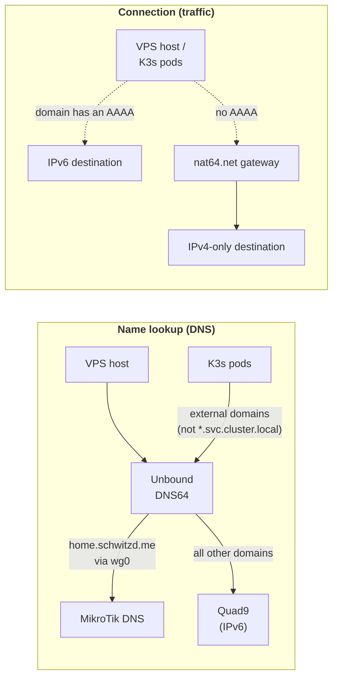
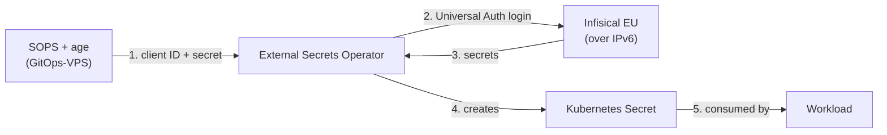
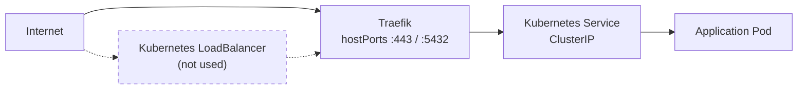

# IaC-VPS

This repository documents and automates the setup of my VPS using **IaC** and **FluxCD**. It is part of my home infrastructure and acts as the always-on, internet-facing arm of it.

The VPS is connected to my [home network](https://github.com/Schwitzd/IaC-HomeRouter) via a **WireGuard** tunnel over IPv6, using a [Route64 tunnel broker](https://www.schwitzd.me/posts/mikrotik-tunnelbroker-with-route64/).

The underlying host is a small UP-Network instance, the [VPS Basic Intel S](https://up-network.ch/services/vps-hosting), with 4 GiB of RAM, running **Debian**.

## Requirements

All commands in this repository are run from the **control machine** (the laptop used to manage the VPS). It needs:

| Tool | Purpose |
|---|---|
| `ansible`, `ansible-lint`, `pre-commit` | Run the playbooks and validate changes (`pip install -r requirements.txt`) |
| `sops` | Encrypt and edit the Infisical credentials in `GitOps-VPS` |
| `age` | Provides `age-keygen` to create the SOPS keypair |
| `tofu` | [OpenTofu](https://opentofu.org), creates the Infisical machine identity (`terraform/`) |
| `infisical` | [Infisical CLI](https://infisical.com/docs/cli/overview), log in to get the token used by OpenTofu |
| `git` | Work with `GitOps-VPS` |

The Flux CLI and `kubectl` are installed on the VPS by the playbooks, they are not needed on the control machine.

Install the needed Ansible roles and collections (from the `ansible/` directory):

```sh
ansible-galaxy collection install -r requirements.yaml --force
ansible-galaxy role install -r requirements.yaml --force
```

## Bootstrap

Bootstrap process will:

1. Create a dedicated VPS user
1. Provision and configure SSH public key authentication for the VPS user

```sh
# Bootstrap the VPS user
ansible-playbook -i inventory.yaml playbooks/bootstrap-user.yaml -u root --ask-pass -e 'ansible_ssh_common_args="-o PubkeyAuthentication=no -o PreferredAuthentications=password -o IdentitiesOnly=yes"'
# Boostrap SSH keys
ansible-playbook -i inventory.yaml playbooks/bootstrap-ssh.yaml -u root --ask-pass -e 'ansible_ssh_common_args="-o PubkeyAuthentication=no -o PreferredAuthentications=password -o IdentitiesOnly=yes"'
```

## Host

Provision host-level configuration (SSH hardening, base services, Nftables, etc...):

```sh
ansible-playbook -i inventory.yaml playbooks/host.yaml
```

### Wireguard

After the `host` playbook has successfully created the WireGuard interface, retrieve the VPS public key with:

```sh
sudo wg show wg0 public-key
```

This key is required to configure the corresponding peer on the MikroTik router.

### DNS

The VPS is **IPv6-only**, and some destinations it needs (for example `github.com`) only have IPv4 addresses. Name resolution is handled by [Unbound](https://nlnetlabs.nl/projects/unbound/about/) on the host, which provides three things:

- **Split DNS for the home zone**: `home.schwitzd.me` is forwarded to the MikroTik router through the WireGuard tunnel.
- **Public DNS for everything else**: forwarded to Quad9 over IPv6.
- **DNS64**: when a name has **no** real AAAA record, Unbound synthesizes one inside the [nat64.net](https://nat64.net) prefix, so only traffic to IPv4-only hosts goes through the NAT64 gateway.

The host uses Unbound through `/etc/resolv.conf` (`nameserver ::1`). Pods use the CoreDNS packaged with K3s, which answers in-cluster names (`*.svc.cluster.local`) itself and forwards every external name (for example `github.com`) to Unbound on the node address (the kubelet hands CoreDNS `/etc/rancher/k3s/resolv.conf`, which points at it, instead of the host's `::1`).



Apply it with:

```sh
ansible-playbook -i inventory.yaml playbooks/host.yaml --tags dns
```

Check that DNS64 works from the VPS:

```sh
dig +short AAAA github.com @::1   # should return an address in the NAT64 prefix
dig +short AAAA codeberg.org @::1 # should return the real AAAA, not the NAT64 prefix
```

## K3s

K3s ships with Traefik and a service load balancer, but both are disabled: Traefik is deployed through GitOps so its configuration lives in git, and the load balancer is unnecessary because Traefik binds the node's ports directly with `hostPort`. CoreDNS is kept enabled, since Flux itself needs cluster DNS to reach GitHub during bootstrap. The built-in network policy controller is explicitly enabled (`disable-network-policy: false`), so `NetworkPolicy` resources are enforced on top of Flannel. Secrets are encrypted at rest in etcd. The node's IPv6 address is filled in from Ansible facts when `ansible/playbooks/templates/k3s-config.yaml.j2` is rendered to `/etc/rancher/k3s/config.yaml`:

```yaml
write-kubeconfig-mode: "644"
flannel-ipv6-masq: true
disable-cloud-controller: true
disable:
  - servicelb
  - traefik
disable-network-policy: false
kubelet-arg:
  - "resolv-conf=/etc/rancher/k3s/resolv.conf"
node-ip: "<ipv6-gua>"
node-external-ip: "<ipv6-gua>"
tls-san:
  - "vps.schwitzd.me"
secrets-encryption: true
cluster-cidr: "fd42:10:42::/56"
service-cidr: "fd42:10:43::/112"
```

`flannel-ipv6-masq` is required because pods only have ULA addresses and are masqueraded behind the node's address to reach the internet.

Deploy the config before installing K3s:

```sh
ansible-playbook -i inventory.yaml playbooks/k3s.yaml --tags k3s-install-config
```

Then proceed with the installation. The installer downloads from `github.com`, which has no IPv6; this works through the [DNS64/NAT64](#dns) setup, so configure DNS first:

```sh
curl -sfL https://get.k3s.io | INSTALL_K3S_VERSION="v1.34.4+k3s1" sh
```

Once Kubernetes is installed, run the rest of the playbook:

```sh
ansible-playbook -i inventory.yaml playbooks/k3s.yaml
```

### Secrets

Secrets are handled by three technologies, each with a single job:

- [Infisical](https://infisical.com): the **secret store**, where every workload secret lives.
- [External Secrets Operator](https://external-secrets.io) (ESO): **pulls** the secrets into the cluster as regular Kubernetes `Secret` objects.
- [SOPS](https://github.com/getsops/sops) with [age](https://github.com/FiloSottile/age): encrypts in git the only credential ESO needs to reach Infisical.

[OpenTofu](https://opentofu.org) provisions the Infisical side, the project and the machine identity used by ESO.



#### SOPS Bootstrap

The only secret stored in `GitOps-VPS` is the Infisical credentials, everything else is pulled from Infisical by ESO. It is encrypted with SOPS and age, and Flux decrypts it in-cluster with the age private key.

1. Generate the age keypair on the control machine:

   ```sh
   age-keygen -o ~/.config/sops/age/keys.txt
   ```

1. Put the **public** key in `.sops.yaml` in `GitOps-VPS`. It is only used to encrypt secrets.
1. Back up `keys.txt` (the **private** key) in a password manager. It is never committed to git.

> [!IMPORTANT]
> The age private key can decrypt every secret in the repository, including its git history. If it leaks, generate a new keypair, re-encrypt the SOPS files, rotate the Infisical client secret, and update `sops-age` in the cluster. If it is lost, the Infisical credentials have to be re-created, the secrets themselves are safe in Infisical.

The private key is loaded into the cluster during the [FluxCD](#fluxcd) bootstrap, right after this.

#### Infisical

I decided to go with the SaaS version, so the VPS does not depend on the [farm cluster](https://github.com/Schwitzd/IaC-HomeK3s) to get its secrets. I use the **EU region** because I live there but, more importantly, because it is the only region (at time of writing) reachable over IPv6, which is all this VPS has.

ESO authenticates with a [Machine Identity](https://infisical.com/docs/documentation/platform/identities/machine-identities) using [Universal Auth](https://infisical.com/docs/documentation/platform/identities/universal-auth). A **client ID** and a **client secret** that ESO exchanges for a short-lived access token on every login. The secrets themselves are organised in folders as `/<app>/<group>/<KEY>` (for example `/stocks-alert/cosmos/connection_string`), and the values are not managed by OpenTofu to keep them out of the state.

Create the machine identity, from the `terraform/` directory:

1. Create `variables_private.tfvars` (ignored by git) with the **organization** and **project IDs**:

   ```hcl
   infisical_org_id     = "<organization-id>"
   infisical_project_id = "<project-id>"
   ```

1. Log in to the EU instance and export the session token, which the provider uses to authenticate:

   ```sh
   infisical login --domain https://eu.infisical.com
   export INFISICAL_TOKEN=$(infisical user get token --domain https://eu.infisical.com --plain --silent)
   ```

1. Apply the code. It imports the project and creates the `eso-vps` identity, its Universal Auth configuration, the client secret and the project membership:

   ```sh
   tofu init
   tofu apply -var-file=variables_private.tfvars
   ```

1. Read the credentials and write them manually into the encrypted ESO sops secret:

   ```sh
   tofu output -raw eso_client_id
   tofu output -raw eso_client_secret
   ```

### FluxCD

The cluster is reconciled by FluxCD from the [GitOps-VPS](https://github.com/Schwitzd/GitOps-VPS) repository. Only the source, kustomize and helm controllers are installed to keep memory usage low. Flux syncs the `cluster/` path of the repository. ESO is deployed by Flux too, first the operator and then its configuration.

Bootstrap sequence, run from the control machine:

1. Have the SOPS age key ready on the control machine (previous section, [SOPS Bootstrap](#sops-bootstrap)), and the Infisical credentials already committed in `GitOps-VPS` ([Infisical](#infisical)).
1. Create a short-lived, fine-grained GitHub token (*Settings → Developer settings → Personal access tokens → Fine-grained tokens*):
   - Resource owner: `Schwitzd`, repository access: only `GitOps-VPS`
   - Repository permissions: **Administration** (read and write), **Contents** (read and write), **Metadata** (read-only, preselected)
1. Run the FluxCD bootstrap playbook to install it:

   ```sh
   export GITHUB_TOKEN=<pat>
   ansible-playbook -i inventory.yaml playbooks/bootstrap-flux.yaml
   ```

1. Verify on the VPS that Flux is syncing:

   ```sh
   flux get sources git
   flux get kustomizations
   kubectl get clustersecretstore
   ```

   On GitHub, *GitOps-VPS → Settings → Deploy keys* should list the Flux key with *Allow write access* unchecked.

1. Delete the token on GitHub. It is only used by the bootstrap command and is not stored in the cluster, where only the read-only deploy key stays. Create a new one if you need to run the bootstrap again.

### Secrets in the cluster

The External Secrets Operator (ESO) is used to get the secrets from Infisical into the cluster. For each secret, an `ExternalSecret` tells ESO what to fetch from Infisical and which Kubernetes `Secret` to create from it:

1. Create the secret in the `VPS` project, in a folder per app and group, for example `/stocks-alert/mailer` with the key `API_KEY`.
1. Add an `ExternalSecret` next to the app in `GitOps-VPS`. It references the secret by its absolute path and creates a regular Kubernetes `Secret` with the name and keys the workload expects:

   ```yaml
   apiVersion: external-secrets.io/v1
   kind: ExternalSecret
   metadata:
     name: auth-mailer-stocks-alert
     namespace: stocks
   spec:
     refreshInterval: 1h
     secretStoreRef:
       kind: ClusterSecretStore
       name: infisical
     target:
       name: auth-mailer-stocks-alert
     data:
       - secretKey: API_KEY
         remoteRef:
           key: /stocks-alert/mailer/API_KEY
   ```

### Network policies

Pod traffic is restricted with standard Kubernetes `NetworkPolicy` resources, enforced by the network policy controller embedded in K3s (kube-router), which is explicitly enabled with `disable-network-policy: false`. It currently runs on `iptables-nft`, and I will switch to pure nftables as soon as K3s supports it. The policies are standard resources, so nothing in `GitOps-VPS` changes.

**Policy model**, defined in `GitOps-VPS` under `network-policies/`:

- A `default-deny-all` policy (ingress and egress) in every application namespace, which means all except the system ones. Nothing is allowed unless a policy says so, and that includes DNS.
- The system namespaces are left out: K3s needs `kube-system` open, and Flux creates its own policies in `flux-system` during the bootstrap.
- Allow rules are added per app, together with the app. If the Helm chart ships its own `NetworkPolicy` (for example cert-manager), that is used.

**Rollout**, the `network-policies` Kustomization is enabled first, which is harmless while the namespaces are empty. Each app is then enabled together with its allow rules.

**Verify** that the policies are applied and enforced:

```sh
kubectl get networkpolicy -A
```

### Traefik

This cluster does not use a Kubernetes **LoadBalancer**, as it runs on a single VPS where the node itself already owns the public IP. Instead, Traefik is configured with `hostPorts` and binds directly to the node's network interfaces on ports 443 (HTTPS) and 5432 (PostgreSQL). Routing is handled via the **Gateway API**, using `HTTPRoute` resources for HTTPS and a `TCPRoute` for PostgreSQL. Incoming traffic follows a simple and explicit path, avoiding unnecessary load-balancer layers:



Traefik example of port configuration:

```yaml
ports:
  websecure:
    port: 443
    hostPort: 443
    expose:
      default: true
    exposedPort: 443
```

## Swap

The VPS is a tiny instance, so a swapfile is provisioned at `/swapfile` by the `host` Ansible playbook to avoid out-of-memory kills under memory pressure.

K3s [supports swap](https://kubernetes.io/docs/concepts/cluster-administration/swap-memory-management/) as of Kubernetes 1.28, so running it alongside a swap-enabled node is a supported and tested configuration.

`vm.swappiness` is set to `10` (via `/etc/sysctl.d/99-swappiness.conf`), which strongly biases the kernel toward keeping processes in RAM and only using swap as a last resort. The default value of `60` would cause premature swapping on a low-memory host, degrading latency for running workloads.

Swap usage per pod can be inspected with:

```sh
kubectl top pods --show-swap -A
```
